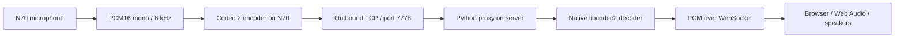

# Nokia N70 microphone streaming with Codec 2

Start with [QUICKSTART.md](QUICKSTART.md) to run the Python server on macOS or
Linux. Use [WINDOWS_CLIENT_PROMPT.md](WINDOWS_CLIENT_PROMPT.md) later on the PC
with the Symbian SDK to implement the phone publisher against this server.

This guide describes a one-way live audio link: start recording on a Nokia N70,
send compressed speech over the Internet to your server, and open a page on that
server to listen in a modern browser.

The directory includes a reference proxy, a browser listener, and a desktop test
sender. **The Symbian microphone/encoder application is not implemented here.**
The phone sections are an implementation plan, with small API examples and
explicit hardware verification steps. Real-time encoding on an N70 remains an
open question until measured on the device.

**CPU feasibility is the first phone milestone.** Upstream explicitly requires
a hardware FPU for real-time operation of its ordinary implementation. Treat
N70 as a software floating-point target and do not assume a normal C port can
keep up. Read [N70_FEASIBILITY.md](N70_FEASIBILITY.md) before implementing the
client; a fixed-point encoder may require substantial additional work.

## 1. Architecture and project boundaries



Compression happens **on the phone**. Decoding happens **on the server**. The
browser receives uncompressed PCM and schedules it with Web Audio. It does not
need a Codec 2 plugin, a WASM codec, or microphone permission.

This matches the requested use case without adding a return audio path, acoustic
echo cancellation, a SIP stack, or WebRTC negotiation. Codec 2 supplies speech
compression; this project supplies connection management, framing, authentication,
fan-out, buffering, and browser playback.

The TCP ingress is a separate service from the existing Telegram protocol:

| Service | Default address | Purpose |
| --- | --- | --- |
| Existing `server/tg_proxy.py` | Existing configuration, normally port 7777 | Telegram text messages |
| `codec2/proxy.py` TCP listener | `127.0.0.1:7778` | Codec 2 microphone publisher |
| `codec2/proxy.py` HTTP listener | `127.0.0.1:8080` | Browser page and `/listen` WebSocket |

Do not send audio through Telegram `SEND`/`POLL`, text escaping, or the existing
line parser. Binary audio requires its own framing and continuously writable
connection. The existing proxy does not need modification.

## 2. What is included

| File | Responsibility |
| --- | --- |
| [proxy.py](proxy.py) | One authenticated TCP publisher; up to eight browser listeners; decode once and fan out PCM |
| [common.py](common.py) | Native Codec 2 binding, frame constants, packet validation |
| [listener.html](listener.html) | Listening token, Start/Stop controls, bounded Web Audio scheduling |
| [send_pcm.py](send_pcm.py) | Encode a desktop PCM recording and transmit it at microphone speed |
| [requirements.txt](requirements.txt) | Python HTTP/WebSocket dependency |
| [test_proxy.py](test_proxy.py) | Protocol and integration checks using real libcodec2 |
| [config.py](config.py) | Validated TOML settings, environment overrides, private credential generation |
| [QUICKSTART.md](QUICKSTART.md) | macOS/Linux startup, test tone, configuration, and health check |
| [WINDOWS_CLIENT_PROMPT.md](WINDOWS_CLIENT_PROMPT.md) | Ready-to-copy task for the future Symbian implementation |
| [N70_FEASIBILITY.md](N70_FEASIBILITY.md) | FPU limitation, baseline benchmark, and fixed-point investigation |

The implementation is intentionally a small, single-stream prototype. It has no
audio archive, multi-phone directory, viewer accounts, browser-to-phone audio,
automatic browser reconnection, or built-in TLS termination.

## 3. Speech format and initial operating point

The server's initial compatibility format is Codec 2 mode **3200**. This choice
does not establish that the N70 can encode it in real time. Feed it signed 16-bit mono
samples at 8000 samples/second. One frame consumes 160 samples (20 ms) and emits
8 packed bytes. The native mode identifier is `CODEC2_MODE_3200`, whose numeric
value is **0**; do not call `codec2_create(3200)`.
[Codec 2 public API](https://github.com/drowe67/codec2/blob/1.2.0/src/codec2.h)

Suggested settings for this protocol:

| Parameter | Initial value |
| --- | --- |
| Microphone format | PCM16, mono, 8000 Hz |
| Codec mode | 3200 |
| Frames per network record | 5 |
| Audio per record | 100 ms |
| Codec payload per record | 40 bytes |
| Record header | 12 bytes |
| Browser initial scheduling lead | 200 ms |
| Maximum frames accepted in a record | 10, or 200 ms |

Five frames are a transport batching choice, not a new codec frame size. The
encoder is called five times, once for each 160-sample slice.

Bandwidth calculations, using decimal bytes:

```text
Raw microphone PCM:          8000 * 2             = 16000 bytes/s
Codec 2 speech payload:      3200 / 8             =   400 bytes/s
Application framing:        10 records/s * 12     =   120 bytes/s
Phone application stream:    400 + 120            =   520 bytes/s
Codec payload per minute:    400 * 60             = 24000 bytes
Browser PCM per listener:    16000 + 120          = 16120 bytes/s
```

TCP/IP, acknowledgements, WebSocket headers, TLS, and mobile-network overhead are
additional. Billing and wire usage are not equal to the codec bitrate. Server
egress grows with the number of listeners even though decoding is shared.

Codec 2 targets intelligible low-bitrate speech. Evaluate it with actual spoken
recordings, including pauses and background noise. It is not a general-purpose
music codec. Lower-bitrate modes can be investigated later; a lower bitrate does
not establish a lower CPU cost. [Codec 2 design documentation](https://github.com/drowe67/codec2/blob/1.2.0/doc/codec2.tex)

## 4. Run the proxy before working on Symbian

For a shorter macOS/Linux setup with generated credentials, use
[QUICKSTART.md](QUICKSTART.md). The environment-only setup below is also
supported. If `codec2/config.toml` exists, it is loaded automatically; environment
variables override its values.

These commands describe a Linux server or desktop. Run them yourself on the
intended machine; they do not deploy anything automatically.

### Install the runtime

Use Python 3.11 or later. On Debian/Ubuntu, install Python's virtual environment
support and the native Codec 2 library. The `codec2` package supplies command-line
tools; `libcodec2-dev` also pulls in the matching shared runtime library.

```sh
sudo apt-get update
sudo apt-get install python3-venv libcodec2-dev codec2 ffmpeg
cd /path/to/s60-tgpager/codec2
python3 -m venv .venv
. .venv/bin/activate
python -m pip install -r requirements.txt
```

If your distribution has different package names, locate its shared `libcodec2`
package. Python uses `ctypes` to call the library; there is no separate Python
Codec 2 package to install.

Check detection:

```sh
python -c 'import ctypes.util; print(ctypes.util.find_library("codec2"))'
```

If that prints `None`, set `CODEC2_LIB` to the full library path:

```sh
export CODEC2_LIB=/absolute/path/to/libcodec2.so
```

On macOS a source build produces a `.dylib`; use its absolute path instead.
The Python process and library must have matching CPU architecture and bitness.

### Generate credentials and start

Generate the two tokens separately:

```sh
python -c 'import secrets; print(secrets.token_hex(32))'
python -c 'import secrets; print(secrets.token_hex(32))'
```

Copy the first result into `C2_PUBLISH_TOKEN` and the second into
`C2_LISTEN_TOKEN`. Tokens must contain 32-128 ASCII letters, digits, underscores,
or hyphens. Hex tokens generated above meet that rule.

```sh
export C2_PUBLISH_TOKEN='PASTE_FIRST_GENERATED_TOKEN_HERE'
export C2_LISTEN_TOKEN='PASTE_SECOND_GENERATED_TOKEN_HERE'
python proxy.py
```

The placeholders above must be replaced. Keep the tokens available in the same
shell for the desktop sender, or export the publishing token in its shell too.

Open `http://127.0.0.1:8080/` on the same computer, enter the **listening** token,
and click **Listen**. The page should say that it is waiting for the phone.
The browser needs the click to start audio; loading the page alone does not
start playback.

### Send a desktop recording

Convert a spoken audio file to headerless PCM:

```sh
ffmpeg -i speech.wav -ac 1 -ar 8000 -c:a pcm_s16le -f s16le speech-8k.pcm
python send_pcm.py speech-8k.pcm
```

The sender reads five codec frames at a time, compresses them using native
libcodec2, waits until the corresponding samples would have been captured, and
sends a binary record. It pads the final incomplete codec frame with silence.
Do not pass a WAV container directly: its header would be interpreted as samples.

Expected result: the proxy reports a connected publisher, the page says
“Phone connected. Listening…”, and speech plays. At file EOF the publisher
disconnects; the page returns to waiting. There is no audio replay for listeners
who connect after a recording has finished.

Run automated checks from the repository root:

```sh
python -m unittest discover -s codec2 -p 'test_*.py' -v
```

The tests need the shared library and aiohttp. They open loopback sockets and
check real encoding/decoding, split TCP records, authentication, one-publisher
ownership, two simultaneous listeners, gap signalling, and bounded viewer queues.

## 5. Building the pinned Codec 2 reference

Use upstream release `1.2.0` as the initial shared reference for the phone port
and server. This avoids debugging a moving source tree at the same time as a
new platform port. The reference proxy was checked against this release.

If no suitable native package is available:

```sh
git clone --depth 1 --branch 1.2.0 https://github.com/drowe67/codec2.git codec2-upstream
cmake -S codec2-upstream -B codec2-build \
  -DCMAKE_BUILD_TYPE=Release -DBUILD_SHARED_LIBS=ON \
  -DCMAKE_POLICY_VERSION_MINIMUM=3.5
cmake --build codec2-build --target codec2 c2enc c2dec --parallel 4
```

The policy setting allows newer CMake versions to configure this older release.
Install a C compiler, CMake, and the platform build tools first. Locate the built
library under `codec2-build/src/` and point `CODEC2_LIB` at it. A system install
is not required. Do not commit the build tree into this directory.

For an offline sanity check, use the built tools:

```sh
codec2-build/src/c2enc 3200 speech-8k.pcm speech-3200.bit
codec2-build/src/c2dec 3200 speech-3200.bit speech-decoded.pcm
ffplay -f s16le -ar 8000 -ac 1 speech-decoded.pcm
```

Paths assume the source and build directories are in the current directory.
These `.bit` bytes are raw packed frames, not the network protocol below.
Files with a `.c2` container header must not be sent as raw frames.

## 6. Phone-to-proxy protocol: handshake

The phone opens an outbound IPv4 TCP socket to the proxy's address and port
7778. An outbound connection works through ordinary mobile NAT; the phone
does not need a public IP or an inbound port. Availability still depends on
the SIM, data plan, APN, coverage, and server firewall.

Send this ASCII line, terminated by one LF byte (`0x0a`):

```text
C2LIVE 1 <publishing-token> 3200\n
```

Here `\n` means the actual LF byte. There is one space between fields, no CR,
no UTF-8 BOM, and no surrounding quotes.

The maximum handshake is 192 bytes, with a 10-second deadline. Replies:

| Reply | Meaning |
| --- | --- |
| `OK\n` | Authenticated and reserved the publisher slot; binary records may follow |
| `ERR auth\n` | Publishing token rejected; connection closes |
| `ERR busy\n` | Another publisher owns the slot; connection closes |
| Connection closes without a reply | Malformed/unsupported handshake or server failure |

Wait for `OK` before sending audio. Accumulate incoming bytes until LF: one
socket read is not necessarily one reply. The initial implementation only
accepts mode 3200. Changing the mode requires coordinated updates to both ends.

## 7. Phone-to-proxy protocol: binary records

Every record is a 12-byte header followed immediately by its payload. Header
integers are unsigned and **big-endian** (network byte order):

| Offset | Size | Field | Meaning |
| --- | --- | --- | --- |
| 0 | 4 | `sequence` | Record counter, initially zero; increments once per constructed record |
| 4 | 4 | `first_sample` | Capture sample index of the first frame, initially zero |
| 8 | 2 | `frame_count` | Number of packed codec frames, 1 through 10 |
| 10 | 2 | `payload_bytes` | Must equal `frame_count * 8` |
| 12 | variable | payload | Concatenated Codec 2 frames, in capture order |

For five frames, the first three headers are:

```text
sequence    first_sample    frame_count    payload_bytes
0           0               5              40
1           800             5              40
2           1600            5              40
```

`first_sample` is measured in **8000 Hz samples**, not milliseconds or PCM bytes.
Advance the sample index for captured frames even when dropping unsent audio.
If a queued record is discarded, its sequence number remains consumed. A capture
gap can also advance `first_sample` without skipping a record number.

Both 32-bit counters wrap modulo `2^32`. Receivers reject backwards jumps using
unsigned modular differences; a forward timestamp gap must be a whole multiple
of 160 samples. Every new TCP session must start at sequence zero and sample zero.

A forward gap causes this proxy to recreate the decoder and flag a discontinuity
to browsers. Missing speech is skipped; it is not reconstructed or filled with
invented codec bytes. A decoder reset can create a brief audible transient.

First header in hex, for five frames:

```text
00 00 00 00  00 00 00 00  00 05  00 28
```

Never transmit a native C/C++ struct directly: padding and host byte order can
change the layout. Write integers explicitly, for example:

```cpp
static void PutU32BE(unsigned char* p, unsigned long value)
{
    p[0] = (unsigned char)(value >> 24);
    p[1] = (unsigned char)(value >> 16);
    p[2] = (unsigned char)(value >> 8);
    p[3] = (unsigned char)value;
}

static void PutU16BE(unsigned char* p, unsigned int value)
{
    p[0] = (unsigned char)(value >> 8);
    p[1] = (unsigned char)value;
}
```

On Symbian use fixed-width `TUint32`/`TUint16` in the actual packet builder.
Codec bit packing is supplied by `codec2_encode`; preserve its byte order.
Do not base64-encode, string-escape, or prepend a WAV header to the payload.

TCP is a byte stream: one write can become multiple reads, and several writes
can arrive in one read. The proxy uses `readexactly(12)`, validates lengths,
and then uses `readexactly(payload_bytes)`. The phone must not rely on TCP packet
boundaries either. This protocol has no per-record reply; successful socket
write completion is not a server audio acknowledgement.

## 8. Server decoding and listener isolation

`common.py` declares ctypes argument and result types explicitly, including the
pointer returned by `codec2_create`. Omitting the pointer return type can truncate
addresses on a 64-bit server. PCM is serialized explicitly as little-endian
signed 16-bit values, independent of host byte order.

One publisher owns one decoder state. Normal records reuse that state; creating
a decoder for every frame would lose continuity. Reconnection and signalled
gaps create new states. All listeners receive the same decoded PCM bytes.

Each listener has an independent queue with eight entries. When it fills, the
proxy discards that listener's queued entries, sends a discontinuity marker,
and retains new audio. The publisher never waits for browser network writes.
With five frames per record, eight audio entries represent about 800 ms; with
the maximum ten frames, they represent up to 1.6 seconds. Control entries also
occupy queue slots.

The proxy allows 15 seconds for the next record header and five seconds for a
record body. A timed-out or truncated publisher releases the slot. Browser
writes have a two-second deadline. These settings are prototype choices, not
guarantees of a particular mobile-network latency.

## 9. Server-to-browser protocol

The browser opens `/listen` on the same HTTP origin, then sends one text message:

```json
{"token":"YOUR_LISTENING_TOKEN"}
```

Authentication must arrive within five seconds. The server checks the browser's
`Origin` and the listening token, then sends status/control messages as JSON and
PCM records as binary WebSocket messages. A listening token grants access to
this single live microphone stream. It does not grant permission to publish.

JSON events:

```json
{"event":"status","online":true,"rate":8000,"format":"s16le","channels":1}
{"event":"stream_start"}
{"event":"discontinuity"}
```

`online` can be false while a listener waits for a publisher. `stream_start`
marks a new publisher session; it also tells listeners to discard scheduled
audio from the previous session.

Each binary message starts with a 12-byte big-endian header:

| Offset | Size | Field |
| --- | --- | --- |
| 0 | 4 | Original publisher record sequence |
| 4 | 4 | First sample index |
| 8 | 2 | PCM sample count, normally 800 |
| 10 | 2 | Flags: bit 0 means discontinuity; other bits reserved |
| 12 | `sample_count * 2` | PCM16 **little-endian** mono samples |

Notice that the last two fields differ from TCP ingress: they are sample count
and flags, not frame count and compressed length. A standard five-frame message
is 1612 bytes: 12 header bytes plus 1600 PCM bytes.

## 10. How browser playback works

The browser listener creates an `AudioContext` in the Listen button handler.
For each record it converts PCM16 to floating point, creates a mono AudioBuffer
with the **source rate of 8000 Hz**, and schedules an AudioBufferSourceNode.
Web Audio performs conversion to the output device's rate. Do not reinterpret
8 kHz samples as 44.1/48 kHz samples: that changes pitch and playback speed.
[Web Audio buffer API](https://developer.mozilla.org/en-US/docs/Web/API/BaseAudioContext/createBuffer)

Sources are scheduled on the audio clock, not with a JavaScript interval. The
initial lead is 200 ms. An underrun restarts buffering; more than 800 ms of
scheduled backlog is discarded. Timestamp gaps also reset the scheduler.
[Audio source scheduling](https://developer.mozilla.org/en-US/docs/Web/API/AudioScheduledSourceNode/start)

The page keeps the token in memory and sends it in the WebSocket authentication
message, rather than putting it in URLs or local storage. It stops when the tab
becomes hidden and requires another Listen click when you return. This keeps
background-tab throttling from building an old audio queue.

This scheduler is a useful prototype, not a complete adaptive jitter buffer. An
AudioWorklet with a fixed-size PCM ring buffer and gentle clock-drift correction
is an appropriate later improvement. Worklets require a secure context; use
HTTPS for remote deployment. [AudioWorklet documentation](https://developer.mozilla.org/en-US/docs/Web/API/AudioWorklet)

## 11. Preparing the N70 development environment

Follow the repository's [S60 development guide](../SKILL.md). The target is
**S60 2nd Edition FP3 / Symbian OS 8.1a**, not S60 3rd Edition, Qt, Android,
or a modern POSIX environment.

Relevant existing files:

- [TgPager/group/tgpager.mmp](../TgPager/group/tgpager.mmp): app sources and linked libraries.
- [TgPager/build.cmd](../TgPager/build.cmd): existing Windows SDK build environment.
- [TgPager/inc/tgpagerengine.h](../TgPager/inc/tgpagerengine.h): socket ownership and active-object patterns.
- [TgPager/src/tgpagerengine.cpp](../TgPager/src/tgpagerengine.cpp): DNS, asynchronous connects, and writes.

The existing batch file has machine-specific Windows paths. Set your own SDK,
Perl, and checkout paths before using it. Keep the SDK and project on the same
drive and avoid spaces in paths. Use the SDK-compatible Perl described in the
local guide. Preserve the existing app UID when extending TG Pager; allocate a
different UID if making a separate audio app.

Start with a separate small audio test app or an isolated module. Integrating
into TG Pager is reasonable after capture and encoding are measured separately.
Do not reshape its existing request/reply text connection into an audio socket.

## 12. Port the codec library, rather than rewriting the algorithm

Start with the [CPU feasibility gate](N70_FEASIBILITY.md). A reference-source port
is a baseline for measurement, not an assumed final N70 implementation. If software
floating point misses the frame budget, evaluate optimized and fixed-point
implementations before proceeding to a complete live client.

Codec 2 already implements the codec. The work is to port its C implementation
and integrate audio capture and networking around it. Upstream uses C99 and
expects ports to other toolchains to be tested.
[Upstream porting guidance](https://github.com/drowe67/codec2#ports-to-non-c99-compilers)

Suggested port workflow:

1. Check out the same `1.2.0` reference on a development computer.
2. Build it natively and save PCM input plus packed-frame output as test vectors.
3. Generate its codebook `.c` files using the host build.
4. Copy the speech-codec sources, required headers, generated tables, and license
   notices into a dedicated vendor directory for the Symbian build.
5. Adapt compiler/library compatibility without changing the speech algorithm.
6. Encode those same vectors on the phone and decode them with the server build.
7. Measure speed and memory on the phone before adding live network traffic.

Do not copy only `codec2.c`. Its dependency graph includes pitch analysis, FFT,
LPC/LSP operations, quantization, interpolation, and codebooks. The upstream
[source build list](https://github.com/drowe67/codec2/blob/1.2.0/src/CMakeLists.txt)
shows generated files and dependencies. Relevant starting points include
`codec2.c`, `codec2_fft.c`, `kiss_fft.c`, `kiss_fftr.c`, `nlp.c`, `sine.c`,
`lpc.c`, `lsp.c`, `quantise.c`, `interp.c`, `phase.c`, `postfilter.c`, `pack.c`,
and `mbest.c`. This is an orientation list, not a tested minimal Symbian source
manifest. Initialization and utility functions can retain dependencies on other
modes even when runtime selection uses only 3200.

Generated table examples include `codebook.c`, `codebookd.c`, `codebookjmv.c`,
and `codebookge.c`; other mode-related tables may also be referenced. Obtain
them from the native build's `src` directory. Keep host code generators out of
the phone executable.

Compatibility areas to inspect:

| Area | What to verify or adapt |
| --- | --- |
| C99 syntax | Declarations inside loops, mixed declarations and statements, inline functions, variable-length arrays |
| Headers | Availability of `stdbool.h`, generated configuration/version headers, fixed-width types |
| Math runtime | `sinf`, `cosf`, `sqrtf`, `log10f`, and any other functions actually referenced |
| Allocation | Matched allocation/free, heap size, initialization failures, stack versus heap buffers |
| C linkage | An `extern "C"` boundary when calling C sources from Symbian C++ |
| Build macros | Disable unused modes consistently across translation units; confirm what is actually removed |
| Platform branches | Avoid selecting desktop/POSIX or STM32-specific code paths accidentally |

Use the SDK's C runtime and math libraries where available, commonly
`estlib.lib` and `libm.lib`; verify exact names and headers in the installed
FP3 SDK. Adding library names alone does not establish ABI compatibility with
an externally built modern ARM library. A Linux `.so` or ARM ELF archive is not
a drop-in Symbian library.

Keep C files as C where feasible. Compiling the entire library as C++ can change
language semantics and introduce different failures. Maintain adaptation patches
and test vectors beside the vendor version information.

## 13. Minimal encoder API usage

After the compatibility layer is working, the central encoding operation is:

```c
struct CODEC2 *encoder = codec2_create(CODEC2_MODE_3200);
/* Check encoder != NULL before using it. */
/* Verify samples_per_frame == 160 and bits_per_frame == 64. */

short pcm[160];
unsigned char compressed[8];

/* Fill pcm with 160 signed microphone samples, then: */
codec2_encode(encoder, compressed, pcm);

/* Append exactly 8 bytes to the current network payload. */
/* Keep encoder alive for subsequent contiguous speech frames. */

/* On final shutdown or when deliberately starting a fresh session: */
codec2_destroy(encoder);
```

This snippet shows API calls, not a complete recording loop. Allocate buffers
with stable lifetime in the real Symbian class. Do not create/destroy the state
on each frame. Treat a new network session as a fresh stream with zeroed counters
and a fresh encoder state.

The phone only needs to encode. The proxy only needs to decode. Do not spend
phone CPU decoding its own stream during normal operation.

## 14. Capture microphone PCM on Symbian

Use `CMdaAudioInputStream` and implement `MMdaAudioInputStreamCallback`. Check
the exact declarations and supported formats in the installed **FP3 SDK**;
later S60 documentation is not a guarantee for this firmware.

The intended sequence is:

```text
Create stream -> Open asynchronously -> MaiscOpenComplete
  -> select/check PCM16, 8000 Hz, mono
  -> set recording gain
  -> ReadL using a persistent descriptor
  -> MaiscBufferCopied receives captured bytes
  -> transfer/copy to a bounded PCM queue
  -> reissue ReadL with a free capture buffer
```

Use `TMdaAudioDataSettings` sample-rate and channel enums for the requested
format. Where supported, request PCM16 through `SetDataTypeL` and the PCM16
FourCC. Capture errors must be surfaced to the UI instead of assuming the
requested format was accepted.

An initial capture buffer can hold 320 or 640 bytes, corresponding to 20 or
40 ms. The implementation must accept arbitrary actual callback lengths:
append bytes to an accumulator, extract complete 320-byte codec inputs, and
retain the remainder. A callback is not inherently one codec frame. If a callback
ends on an odd byte boundary, retain that byte for the next append.

Use an aligned `TInt16` array for `codec2_encode`, copying samples from byte
buffers if needed. Avoid casting an unaligned descriptor pointer to `short*`.
Preserve sign and byte order. Validate the recorded data offline: wrong channel
count, sample rate, gain, or byte order can sound like a codec failure.

Callback lifetime rules matter:

- The descriptor and backing memory passed to `ReadL` must outlive the request.
- Do not recycle a capture buffer while a worker is still reading it.
- Keep capture callbacks short: hand off data and rearm capture promptly.
- Trap leaves at callback boundaries and stop cleanly on recording errors.
- Cancel/stop outstanding work before destroying descriptors or the stream.
- Avoid deleting the audio object from inside its own callback; defer teardown
  through the owning controller.

Use the SDK audio examples and installed header declarations as the final API
reference. There is intentionally no untested, supposedly complete Symbian
capture implementation in this directory.

## 15. Phone classes and concurrency

A practical decomposition is:

| Component | Responsibility |
| --- | --- |
| `CAudioCapture` | Own input stream and persistent PCM buffers; count samples |
| `CCodec2Encoder` | Own native codec state and encode complete 160-sample frames |
| `CAudioPacketQueue` | Own bounded, complete binary records and their timestamps |
| `CAudioWriter` | Own one outstanding asynchronous socket write |
| `CAudioControlReader` | Read handshake replies and detect connection closure |
| `CAudioController` | Start/Stop UI, connection state, retry timers, teardown |

First measure encoding from a prerecorded PCM file. If calls are short enough,
a scheduled encoder active object can drain a small queue. Moving work to an
active object does not make it preemptive: a long `RunL` still blocks other
active objects on that thread.

If encoding blocks capture or the UI, use a dedicated `RThread` with an explicit
bounded queue, synchronization, and ownership rules. Do not allocate memory on
one thread's private heap and free it on another without a deliberately shared
heap arrangement. Preallocated slots are easier to audit than per-frame cross-
thread allocations. A worker thread avoids UI blocking but cannot fix a codec
that requires more CPU time than the available audio duration.

## 16. TCP writer and reconnection on the phone

Use a dedicated `RSocket`. Reuse the existing engine's DNS and retry patterns,
but implement audio-specific state:

```text
Stopped -> Resolving -> Connecting -> Authenticating -> Capturing/Streaming
                                                  failure -> RetryWait
Streaming -> user Stop -> Stop capture -> Cancel I/O -> Close -> Stopped
```

Keep recording off until authentication succeeds, or deliberately discard any
pre-authentication capture. The proxy expects the first transmitted sample to
have sample index zero for the new session.

For every asynchronous write:

1. Build a complete record into an owned descriptor.
2. Keep that descriptor and its backing storage unchanged until completion.
3. Allow only one outstanding write on the writer object.
4. On success release the slot and issue the next queued record.
5. On failure cancel the session and reconnect using a timer.

Do not send descriptors backed by temporary stack buffers. Do not overwrite the
current write buffer with the next packet. If using a send API that reports a
partial byte count, retain the remaining tail and finish it before starting the
next record. With the existing `RSocket::Write` pattern, follow its completion
contract rather than inventing application-level TCP packet boundaries.

Set TCP_NODELAY using the SDK's socket option constants if supported. Batch five
frames to reduce small-write overhead. Avoid sleeps in active-object callbacks;
microphone delivery already supplies real-time pacing.

Use a small unsent-record limit, such as five 100 ms records, and track the age
of the oldest unsent audio. Drop oldest **not-yet-written complete records** when
needed. Never remove bytes from the middle of a record that is already partly
sent. If an in-flight write stalls beyond a selected threshold, such as 1-2
seconds, close the connection and start a new session rather than replaying a
long queue. Handle write cancellation before freeing its buffer.

Reconnect with a bounded backoff, for example 1, 2, 4, 8, then 15 seconds. User
Stop cancels retries. `ERR auth` should require correcting credentials rather
than retrying indefinitely; `ERR busy` can use delayed retry. Provide visible
states such as Recording, Connecting, Disconnected, and Encoder overloaded.

## 17. Benchmark and acceptance gates on the actual N70

The important feasibility test is **encoding**, because the microphone is on
the phone. Moving decoding to the server does not remove that cost.
Upstream's [microcontroller guidance](https://github.com/drowe67/codec2#building-codec-2-for-microcontrollers)
states that real-time operation requires a hardware FPU. The ordinary implementation
must therefore be treated as a high-risk baseline for N70. Compiler soft-float
support makes the operations possible; it does not establish acceptable speed.

Benchmark a release device build against representative speech for at least a
minute. Exclude disk reads from the per-frame codec measurement; measure them
separately. Use a sufficiently fine timer available in the SDK and determine its
frequency rather than assuming ticks equal milliseconds. Batch timing if the
timer is too coarse for a single call.

Record mean, high-percentile, and maximum encoding time per 20 ms frame, plus
memory usage, queue depth, and capture overruns. A useful initial target is
average encoding below roughly 10-12 ms/frame, with enough headroom for capture,
networking, and the UI. This is an engineering target, not a measured N70 result.
Short occasional spikes can be absorbed by buffering; sustained processing above
20 ms/frame cannot keep up indefinitely.

Then run these gates in order:

| Gate | Evidence required |
| --- | --- |
| PCM capture | A recording from N70 is valid 8 kHz mono speech when played on a PC |
| Codec correctness | Phone-generated packed frames decode correctly with the pinned server build |
| CPU feasibility | Encoding remains faster than capture with useful spare time |
| Live uplink | Queue depth stays bounded while microphone and network run together |
| Browser listening | A viewer can join an active stream and hear current speech |
| Failure recovery | Stop, signal loss, disconnect, and reconnect release resources and reset counters |
| Long run | Latency does not grow continuously during a 10-30 minute session |

Use saved vectors to distinguish compiler/math compatibility bugs from capture
bugs. Some numerical differences between architectures may affect quantization;
investigate mismatches against the upstream tests rather than accepting a build
merely because it produces sound.

If real-time encoding is too slow, first profile the actual release build and
check accidental debug code, double-precision promotions, and unnecessary work.
Compare suitable modes empirically. A fixed-point adaptation is a substantial
codec project, not a compiler switch. Encoding offline voice messages is a
different fallback; it does not satisfy continuous live listening.

## 18. Internet deployment

For a remote test, the phone must reach the TCP listener. Change only the TCP
bind address when exposing it:

```sh
export C2_TCP_HOST=0.0.0.0
export C2_TCP_PORT=7778
export C2_HTTP_HOST=127.0.0.1
export C2_HTTP_PORT=8080
export C2_VIEWER_ORIGIN=https://audio.example.com
python proxy.py
```

Replace the example domain with your domain. Open inbound TCP 7778 on the server
firewall and any relevant NAT. Configure the phone with the server's reachable
IPv4 address or hostname, port 7778, and the publishing token. N70 has no Wi-Fi;
use a functioning cellular data connection or a separately configured network
arrangement. Confirm basic TCP connectivity before debugging audio.

Put HTTPS in front of the browser port. A minimal Nginx server block, assuming
valid certificates already exist, is:

```nginx
server {
    listen 443 ssl;
    server_name audio.example.com;
    ssl_certificate /etc/letsencrypt/live/audio.example.com/fullchain.pem;
    ssl_certificate_key /etc/letsencrypt/live/audio.example.com/privkey.pem;

    location / {
        proxy_pass http://127.0.0.1:8080;
        proxy_set_header Host $host;
    }

    location = /listen {
        proxy_pass http://127.0.0.1:8080;
        proxy_http_version 1.1;
        proxy_set_header Host $host;
        proxy_set_header Upgrade $http_upgrade;
        proxy_set_header Connection "upgrade";
        proxy_read_timeout 75s;
        proxy_buffering off;
    }
}
```

The WebSocket location needs the Upgrade headers passed to the backend.
[Nginx WebSocket documentation](https://nginx.org/en/docs/http/websocket.html)

The proxy's explicit `C2_VIEWER_ORIGIN` must exactly match the browser origin,
including scheme and any nonstandard port, without a trailing slash. Behind
HTTPS termination, the backend request itself is HTTP; relying on the default
origin calculation would otherwise reject the HTTPS browser. Serve the page
from `/` on its own host; subpath hosting is not configured in this prototype.

The browser leg then uses HTTPS/WSS. **The reference phone TCP leg is plaintext**:
its token and speech are observable on that transport. HTTPS on the browser side
does not encrypt the phone uplink. Use this reference transport on a trusted
network or through an appropriate protected tunnel; a public deployment with
confidential speech requires a separately designed, N70-compatible protected
uplink. Do not invent encryption or assume modern TLS works in this old SDK.

Run the service under an unprivileged account and a process supervisor, keeping
tokens in its private configuration file or protected environment. The service
caps TCP connections at 16 and browser connections at eight by default, including
connections still authenticating. These limits are configurable. Per-IP admission
control is not implemented; add it at the network boundary if needed.

## 19. Latency, TCP stalls, and clock drift

The 100 ms network record and 200 ms browser lead are only parts of total delay:

```text
capture buffering + codec analysis + record accumulation
+ mobile uplink + server work + browser jitter lead + sound device buffering
```

Measure end-to-end latency, for example with a click/clap near the phone and a
recording of the browser output. Do not promise a sub-second result from the
codec bitrate alone. Mobile latency and outages can dominate.

TCP simplifies NAT traversal and framing but preserves old bytes during loss
recovery. Bounded application queues do not remove bytes already accepted into
kernel buffers or the network. The sample timestamp is relative to capture and
does **not** tell the server the wall-clock age of a packet; this prototype has
no clock-synchronization or age-based ingress rejection. An old stream arriving
at a steady rate can remain delayed even though all application queues are small.

For sustained live use, add sender queue-age and write-duration metrics and
explicit stale-session recovery. Consider a heartbeat/RTT protocol and a
documented age-estimation strategy before claiming a hard latency bound. UDP
with sequence numbers, authentication, and a real jitter buffer can be a later
transport option, but it requires loss handling and its own operational tests.

Phone capture and browser playback clocks also differ slightly. The current
browser scheduler handles drift by occasionally rebuffering or discarding excess
backlog. It does not perform smooth adaptive rate correction. A long-session
implementation should track buffered duration and adjust resampling gently.

## 20. Troubleshooting

| Symptom | First checks |
| --- | --- |
| `libcodec2 not found` | Install native shared library; set absolute `CODEC2_LIB`; match Python architecture |
| Proxy cannot bind | Port already used, wrong interface address, or local firewall/sandbox restrictions |
| Phone cannot connect | APN/data access, reachable IPv4, firewall/NAT, TCP port, DNS, server bind address |
| `ERR auth` | Publishing token, exact spaces/LF, no accidental CR or quotes |
| `ERR busy` | Another sender is connected; stop it or wait for the old connection's timeout |
| Browser WebSocket gets HTTP 403 | `Origin` mismatch; set the public HTTPS origin explicitly |
| Browser connects but is rejected | Listening token differs, authentication was delayed, or limit reached |
| Page says waiting | No publisher has authenticated, or its stream ended |
| Page says listening but no sound | Click Listen, check output device/volume, try desktop speech input, inspect browser console |
| Fast/high-pitched sound | PCM source rate or channel count interpreted incorrectly |
| Noise or distorted speech | WAV header sent as raw PCM, wrong endian/sign, clipping, wrong frame boundaries, mismatched mode |
| Server closes after first record | Wrong header order, size mismatch, first counters not zero, backwards timestamp |
| Phone UI freezes | Long encoder work on the active-scheduler thread, synchronous I/O, or buffer ownership bug |
| Latency grows | Unbounded sender queue, TCP backlog, browser scheduling backlog, or clock drift |
| Short artifacts after loss | Deliberate decoder reset and skipped speech; implement better concealment later |

## 21. Suggested implementation milestones

1. Run desktop sender -> proxy -> browser with real speech.
2. Build and measure a correct encoder from known PCM on N70; investigate fixed
   point/optimization if needed, and pass the CPU gate before full client work.
3. Capture and export clean microphone PCM on N70, without networking.
4. Send a short pre-encoded stream from N70 using the binary protocol.
5. Join live microphone capture, encoding, and a bounded asynchronous writer.
6. Add Start/Stop/status controls and exercise signal loss/reconnection.
7. Measure long-session latency, CPU, memory, audio quality, and battery behavior.
8. Harden deployment and improve the browser jitter buffer if the prototype is useful.

The first deliverable on the phone should be a reliable one-way microphone
publisher. Multiple modes, multi-phone routing, recording, and return audio can
be added after this path works and its resource use is measured.

## 22. Licensing and verification status

Codec 2 is a separate upstream library under LGPL 2.1. Preserve its notices and
review the upstream license when distributing a modified or statically linked
Symbian build. The Python wrapper dynamically loads a separately installed
library; no upstream codec implementation is vendored here.
[Upstream license](https://github.com/drowe67/codec2/blob/1.2.0/COPYING)

The repository checks exercise the proxy against native Codec 2 1.2.0. They do
not establish N70 encoding performance, microphone API behavior on a specific
firmware, browser audio quality, cellular-network latency, or deployment security.
Those require the device and listening tests described above.
